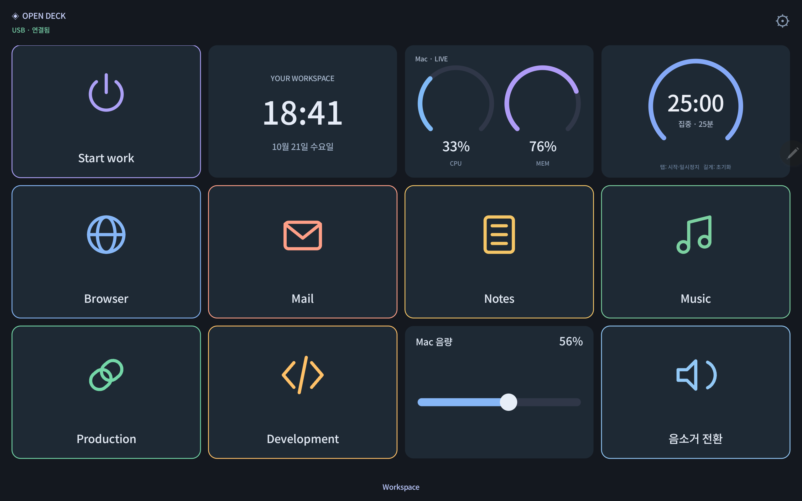

# Open Deck

A local macro deck with a **macOS host and a native Android app**. Build your controls on the Mac, then use a spare phone or tablet as your desk panel.

**Free, MIT licensed, no account, trial, subscription, analytics, or license server.** Android renders directly with Canvas: it contains no WebView or JavaScript engine.



> Version 0.1.0 is a working USB-first alpha for Apple Silicon Macs (macOS 13+) and Android 8+. It implements the core desk-control workflow; it does not claim full feature or plugin compatibility with Macro Deck or Touch Portal.

## Download

[Latest release: macOS app + signed Android APK](https://github.com/Yaklede/open-deck/releases/latest)

The macOS download is an ad-hoc signed developer build, not Apple notarized. You can also build it locally from the source below. The Android APK is signed with a project development key; the key is kept outside this repository.

## What works

| Feature                              | Included                                                               |
| ------------------------------------ | ---------------------------------------------------------------------- |
| Mac desktop app and menu bar control | App bundles the host runtime; no Node installation needed to run       |
| Native Android client                | Portrait/landscape, reconnect, multiple pages, encrypted saved token   |
| Visual deck editor                   | Add, reorder, duplicate, remove, name, color and icon widgets          |
| App and URL launchers                | Native apps, browser URLs, existing Chrome tabs in a chosen profile    |
| Routines                             | Multiple steps, waits, commands, volume, mute and conditional branches |
| Daily automations                    | Execute a configured button at a local time while the host runs        |
| Live widgets                         | CPU, memory, clock, 25-minute/custom countdown, Mac volume slider      |
| Pairing                              | Expiring single-use PIN, per-device scoped tokens, device revocation   |
| Backup                               | Import and export deck JSON                                            |

## 빠른 시작

1. 맥에 **Open Deck.app**, 태블릿에 **Open-Deck-Android.apk**를 설치합니다.
2. 맥에 [Android platform-tools](https://developer.android.com/tools/releases/platform-tools)가 있어야 합니다. Homebrew를 사용한다면 `brew install --cask android-platform-tools`로 설치할 수 있습니다.
3. 태블릿에서 USB 디버깅을 켜고 맥을 허용한 뒤 USB로 연결합니다.
4. 맥에서 Open Deck을 실행합니다. 앱은 연결된 실제 Android 기기에 `adb reverse tcp:8840 tcp:8840`을 설정합니다.
5. 태블릿 앱에 맥 편집기의 6자리 코드를 입력합니다. 이후에는 저장된 연결로 자동 재연결됩니다.
6. 맥에서 위젯을 편집한 뒤 **변경 저장**을 누르면 태블릿에 바로 반영됩니다.

Chrome 버튼의 `프로필`에는 이메일 주소가 아닌 `Default`, `Profile 2` 같은 Chrome 프로필 폴더 이름을 입력합니다. 해당 프로필에서 기존 URL의 탭을 찾고, 없으면 새로 엽니다. macOS가 Chrome 제어 권한을 물으면 본인이 허용해야 합니다.

타이머는 **탭하면 시작/일시정지, 길게 누르면 초기화**됩니다. 음량은 슬라이더를 놓을 때 적용됩니다. 중복 클릭은 실행 대기열에 쌓지 않습니다.

## Build

Host development needs Node.js 22+ and has no npm runtime dependencies:

```sh
npm test
npm start
```

For the desktop app, use macOS with Xcode Command Line Tools and an official Node distribution whose root contains its `LICENSE` file:

```sh
bash scripts/build-macos.sh
# dist/Open Deck.app
```

Build Android with JDK 17+ and Android SDK 35:

```sh
cd android
./gradlew :app:assembleDebug :app:lintDebug
# app/build/outputs/apk/debug/app-debug.apk
```

For a signed release, create your own keystore and a gitignored `android/signing.properties`:

```properties
storeFile=/absolute/path/to/your-keystore.p12
storePassword=your-local-secret
keyAlias=your-alias
keyPassword=your-local-secret
```

Then run `./gradlew :app:assembleRelease`. Never commit the keystore or signing properties.

## Architecture and boundaries

The macOS Swift/AppKit app starts an embedded Node host and opens its local editor in WKWebView. The **Android client is native Java/Canvas**, consumes authenticated server-sent events, and sends only widget IDs and bounded control values. All executable action definitions remain on the Mac.

The host binds exclusively to `127.0.0.1:8840`. USB debugging forwards that loopback port to Android. This release **does not expose a Wi-Fi server**; the APK permits cleartext only for `127.0.0.1` and `localhost`. The editor requires a separate administrator session, checks request origins/Host headers, and cannot be edited using a tablet token.

Settings are in `~/Library/Application Support/OpenDeck/`. They are private to that Mac and never included in source or releases. Device tokens are hashed on the host and encrypted with Android Keystore on the tablet. Logs and timers are local; active countdowns are not restored after a host restart.

Shell actions execute as your logged-in Mac user. Only pair devices you control. Shell configuration belongs in the Mac editor, never in a tablet request.

## Scope of 0.1

USB/ADB transport only; macOS host only; Android client only. No iOS app, Bluetooth, Wi-Fi discovery, nested folders, plugin marketplace, microphone routing, OBS integration, account sync, notarization, screen reader virtual-button navigation, or automatic login launch is implemented yet. The host must stay running. Daily schedules are not replayed after sleep or downtime.

Touch Portal and Macro Deck are separate products and are not modified by Open Deck. Their proprietary companion applications, artwork and licensing systems are not used.

## REA and provenance

[REA](https://github.com/morluto/rea) 6.7.0 was used to statically inspect the public Macro Deck web-client source at tag `v3.0.0-beta.18`: 132 artifacts, 127 parsed JavaScript files, no parse failures. [Analysis receipt](docs/rea-analysis.json) records the evidence digest and exact source commit. This is an independent implementation with a new protocol, not recovered proprietary app code. See [development notes](docs/development.md).

## Licensing

Open Deck code: [MIT](LICENSE). The bundled Android font is Google's Noto Sans KR under [SIL OFL 1.1](assets/fonts/NotoSansKR-OFL.txt). The macOS app bundles Node.js with its distribution license and third-party notices. Gradle wrapper files retain their upstream license. No original product trademarks or icons are included.
