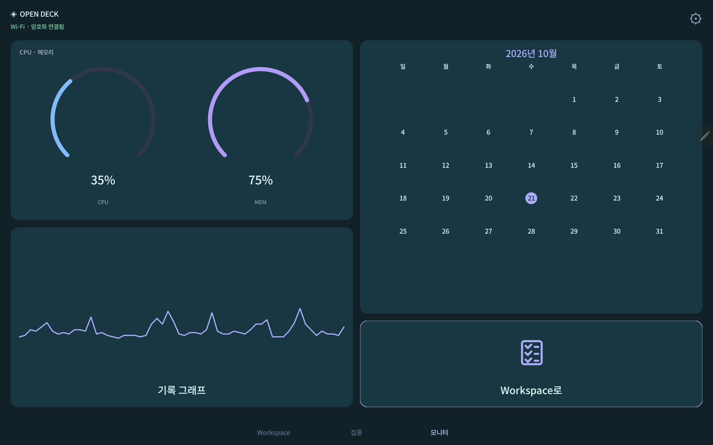

# Open Deck

A local macro deck with a **macOS host and a native Android app**. Build your controls on the Mac, then use a spare phone or tablet as your desk panel.

**Free, MIT licensed, no account, trial, subscription, analytics, or license server.** Android renders directly with Canvas: it contains no WebView or JavaScript engine.



> Version 0.11.1 supports USB + encrypted Wi-Fi on Apple Silicon Macs (macOS 13+) and Android 8+. It implements the core desk-control workflow; it does not claim full feature or plugin compatibility with Macro Deck or Touch Portal.

## Download

[Latest release: macOS app + signed Android APK](https://github.com/Yaklede/open-deck/releases/latest)

The macOS download is an ad-hoc signed developer build, not Apple notarized. You can also build it locally from the source below. The Android APK is signed with a project development key; the key is kept outside this repository.

## What works

| Feature                              | Included                                                                                          |
| ------------------------------------ | ------------------------------------------------------------------------------------------------- |
| Mac desktop app and menu bar control | App bundles the host runtime; no Node installation needed to run                                  |
| USB and Wi-Fi                        | USB registration, certificate-pinned HTTPS, auto/Wi-Fi/USB modes                                  |
| Touch and rendering                  | Immediate press animation, haptics, per-widget updates, bounded concurrent actions                |
| Native Android client                | Portrait/landscape, reconnect, multiple pages, encrypted saved token                              |
| Visual deck editor                   | Independent page grids, drag placement, resize/spans, duplication, undo/redo, themes and images   |
| App and URL launchers                | Native apps, browser URLs, existing Chrome tabs in a chosen profile                               |
| Routines                             | Multiple steps, waits, commands, volume, mute and conditional branches                            |
| Automations                          | Weekday/time schedules, variable changes and experimental plugin events                           |
| Live widgets                         | CPU/memory, clock, timer, volume, text, toggle, slider, graph, monthly calendar, todos and images |
| Mac system monitor                   | Per-core CPU, memory pressure/compression/swap, storage and I/O, network, power/thermal state and top apps |
| Grafana                              | Native system CPU, collection and DB status cards, CPU/MEM/TPS/QPS, actual GiB, configurable risk colors/tablet alerts and shared project selection |
| Service health                       | Response time, 5xx error percentage and RPS below the primary CPU readout, with native history charts |
| Monitoring inbox                     | Project-grouped incidents, acknowledge, 30-minute snooze/resume and persistent recovery history on Mac and Android |
| Pairing                              | Expiring single-use PIN, per-device scoped tokens, device revocation                              |
| Backup                               | Deck JSON with image assets; theme presets                                                        |
| HTTP connectors                      | GET polling, manual webhooks, scalar JSON binding, Keychain Bearer tokens                         |
| Plugins (experimental)               | Trusted local macOS arm64 plugins: actions, eager variable reads and events; capability reporting |

The **모니터** template prioritizes native Grafana system CPU and DB status cards with a shared project filter. Touch or drag the CPU and DB detail charts to inspect a measured sample’s time and value. A compact Mac card opens live CPU, memory, storage, power and network detail tabs. Editable upper/lower thresholds add risk colors, sustained-condition alerts and recovery notifications. See [monitoring setup and metric definitions](docs/monitoring.md).

## Jimin OS 연결

맥 편집기 **변수 · 연동 → Jimin OS → 연결하고 OS 탭 추가**에서 켤 수 있습니다. 연결 기능이 포함된 Jimin OS 맥 앱이 같은 맥에서 실행되고 로그인되어 있어야 합니다.

- 태블릿 하단 **OS** 탭에서 실제 일정, 할 일 마감, 새 업무 요청과 예약 업무를 확인합니다.
- 캘린더 날짜를 누르면 해당 날짜의 일정과 할 일을 볼 수 있고, **맥에서 열기**로 원래 Jimin OS 화면에 이어서 접근합니다. 월 제목을 누르면 이번 달과 다음 달을 전환합니다.
- 업무 요청·예약 업무·일정 추가·AI 비서·할 일·회의 기록을 빠른 실행으로 엽니다. 실제 저장과 업무 전송은 Jimin OS의 기존 확인 흐름을 따릅니다.
- 일정 시작·할 일 마감·새 업무 요청을 연결된 태블릿에 자동으로 알립니다. 알림 시점은 1~120분 전으로 조절하고 끌 수 있습니다. Android 13 이상에서는 알림 권한이 필요합니다.
- 두 맥 앱과 태블릿 연결이 유지되는 동안 전달됩니다. 강제 종료한 태블릿 앱이나 오프라인 기기에 전달하는 클라우드 푸시는 제공하지 않습니다.

Jimin OS 서버 로그인 정보는 Open Deck과 태블릿에 전달하지 않습니다. 이 연결은 Jimin OS 전용 확장으로, Macro Deck 플러그인 호환 어댑터와 별개입니다. [연동 프로토콜](docs/jimin-os.md)을 참고하세요.

## 빠른 시작

1. 맥에 **Open Deck.app**, 태블릿에 **Open-Deck-Android.apk**를 설치합니다.
2. 맥에 [Android platform-tools](https://developer.android.com/tools/releases/platform-tools)가 있어야 합니다. Homebrew를 사용한다면 `brew install --cask android-platform-tools`로 설치할 수 있습니다.
3. 태블릿에서 USB 디버깅을 켜고 맥을 허용한 뒤 USB로 연결합니다.
4. 맥에서 Open Deck을 실행합니다. 앱은 연결된 실제 Android 기기에 `adb reverse tcp:8840 tcp:8840`을 설정합니다.
5. 태블릿 앱에 맥 편집기의 6자리 코드를 입력합니다. 최초 USB 등록 때 맥의 Wi-Fi 주소와 인증서가 함께 저장됩니다.
6. 맥과 태블릿을 같은 Wi-Fi에 연결하면 자동으로 암호화된 무선 연결을 사용합니다. 등록 후 USB 케이블을 빼도 됩니다.
7. 태블릿 오른쪽 위 설정 → **연결 방식 · Wi-Fi / USB**에서 자동(Wi-Fi 우선), Wi-Fi 전용, USB 전용을 선택할 수 있습니다.
8. 공유기에서 맥 IP가 바뀌면 USB를 한 번 연결하거나, 맥 편집기 **연결된 기기**에 표시된 HTTPS 주소를 태블릿 **맥 Wi-Fi 주소 변경**에 입력하세요. 맥 인증서는 그대로 유지됩니다.
9. 맥에서 위젯을 편집한 뒤 **변경 저장**을 누르면 태블릿에 바로 반영됩니다.

Chrome 버튼의 `프로필`에는 이메일 주소가 아닌 `Default`, `Profile 2` 같은 Chrome 프로필 폴더 이름을 입력합니다. 해당 프로필에서 기존 URL의 탭을 찾고, 없으면 새로 엽니다. macOS가 Chrome 제어 권한을 물으면 본인이 허용해야 합니다.

타이머는 **탭하면 시작/일시정지, 길게 누르면 초기화**됩니다. 음량은 슬라이더를 놓을 때 적용됩니다. 중복 클릭은 실행 대기열에 쌓지 않습니다.

## Build

Host development needs Node.js 22+. Install the pinned WebSocket dependency first:

```sh
npm ci
npm test
npm start
```

For the desktop app, use macOS with Xcode Command Line Tools and an official Node distribution whose root contains its `LICENSE` file:

```sh
bash scripts/build-macos.sh
# dist/Open Deck.app
```

Build Android with JDK 17+ and Android SDK 35:

```sh
cd android
./gradlew :app:assembleDebug :app:lintDebug
# app/build/outputs/apk/debug/app-debug.apk
```

For a signed release, create your own keystore and a gitignored `android/signing.properties`:

```properties
storeFile=/absolute/path/to/your-keystore.p12
storePassword=your-local-secret
keyAlias=your-alias
keyPassword=your-local-secret
```

Then run `./gradlew :app:assembleRelease`. Never commit the keystore or signing properties.

## Architecture and boundaries

The macOS Swift/AppKit app starts an embedded Node host and opens its local editor in WKWebView. The **Android client is native Java/Canvas**, consumes authenticated server-sent events, and sends only widget IDs and bounded control values. All executable action definitions remain on the Mac.

The Mac editor and USB API bind to `127.0.0.1:8840`. A separate HTTPS listener on port `8841` serves only the tablet API over the LAN. Editor files and every administrator route are blocked on the LAN listener, including requests carrying an administrator key. Browser-origin requests to that listener are rejected.

At first launch the host generates a private per-install certificate with the macOS system OpenSSL tool. The Android app obtains its SHA-256 fingerprint over an authenticated USB connection, then verifies the exact certificate and its validity on every Wi-Fi TLS connection. It does not trust arbitrary self-signed certificates and does not install a system CA. Device tokens are never sent over unencrypted Wi-Fi; cleartext is allowed only for the USB loopback endpoint. The same paired token and revocation policy apply to both transports.

Initial registration requires USB. Wi-Fi works on the same reachable private IPv4 network; guest-network isolation or a firewall blocking TCP 8841 prevents it. There is no mDNS discovery or router port forwarding. If a DHCP address changes while USB is absent, enter the new HTTPS address in tablet settings. Keep the Mac host running.

Settings are in `~/Library/Application Support/OpenDeck/`. They are private to that Mac and never included in source or releases. Device tokens are hashed on the host and encrypted with Android Keystore on the tablet. Logs and timers are local; active countdowns are not restored after a host restart.

Shell actions execute as your logged-in Mac user. Only pair devices you control. Shell configuration belongs in the Mac editor, never in a tablet request.

## Editing and integrations

Each page has its own grid and design. Open **페이지 디자인 · 배치** for themes, gaps, backgrounds and portrait columns. Drag widgets to free cells or use the corner handle to resize; arrow keys move and Alt+arrow keys resize. Select a widget for its text, icon, image and appearance controls. **집중** and **모니터** templates provide larger native widgets. The preview is an editor approximation; the Android app draws the live clock, calendar, graphs and controls natively.

Use **변수 · 연동** for typed values and HTTP endpoints. Labels accept `{{variableName}}`; toggles require Boolean and sliders require numeric user variables. Graphs retain up to 120 samples in memory. Todos and user values survive host restarts. The calendar shows the local month; it does not fetch online events. HTTP polling is GET-only; write methods execute manually. Bearer tokens are stored in this Mac's Keychain and excluded from backups. Do not put secrets in ordinary variables or URLs. OAuth and service-specific sign-in are not implemented.

The same section registers unpacked **trusted, self-contained macOS arm64** Macro Deck 3 plugin folders. This is an experimental subset, not full compatibility or a store installer. The adapter supports action execution, eager variable reads and published-event triggers. Plugins needing configuration flows, custom UI or unsupported host APIs will require more work. See [coverage and exact limits](docs/feature-coverage.md) and [all 36 assessed plugins](docs/plugin-inventory.md).

The host must stay running. No iOS client, Windows/Linux host, Bluetooth, automatic discovery, marketplace, notarization, dedicated keyboard/mouse editor or automatic login launch is implemented. Schedules missed during sleep or downtime are not replayed.

Touch Portal and Macro Deck are separate products and are not modified by Open Deck. Their proprietary companion applications, artwork and licensing systems are not used.

## REA and provenance

[REA](https://github.com/morluto/rea) 6.7.0 was used to statically inspect the public Macro Deck web-client source at tag `v3.0.0-beta.18`: 132 artifacts, 127 parsed JavaScript files, no parse failures. [Analysis receipt](docs/rea-analysis.json) records the evidence digest and exact source commit. This is an independent implementation with a new protocol, not recovered proprietary app code. See [development notes](docs/development.md).

## Licensing

Open Deck code: [MIT](LICENSE). The bundled Android font is Google's Noto Sans KR under [SIL OFL 1.1](assets/fonts/NotoSansKR-OFL.txt). The macOS app bundles Node.js with its distribution license and third-party notices. The `ws` dependency is MIT licensed and its license is bundled with the desktop app. Public Macro Deck protocol descriptor metadata is attributed under [Apache 2.0](docs/licenses/MacroDeck-Protocol-LICENSE) with [notice](docs/licenses/MacroDeck-Protocol-NOTICE). Gradle wrapper files retain their upstream license. No original product trademarks or icons are included.
