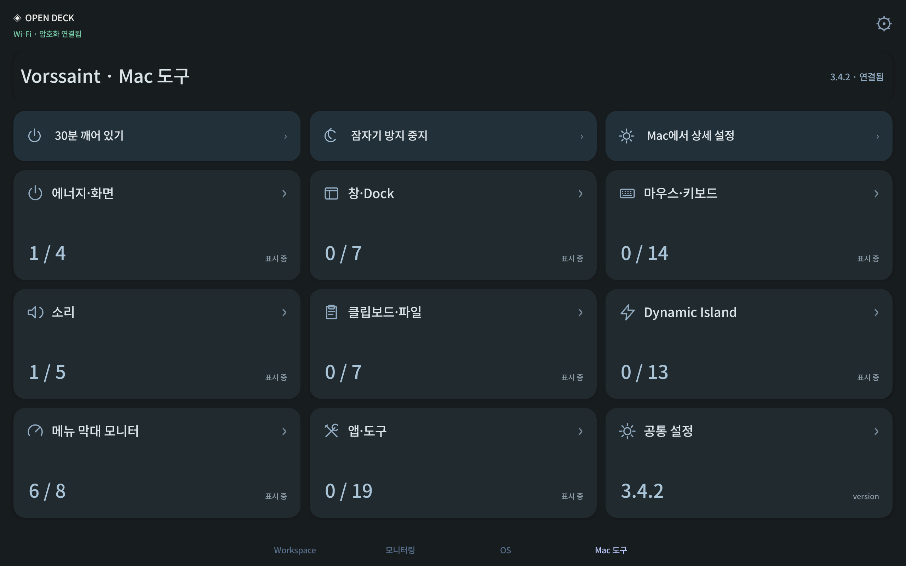
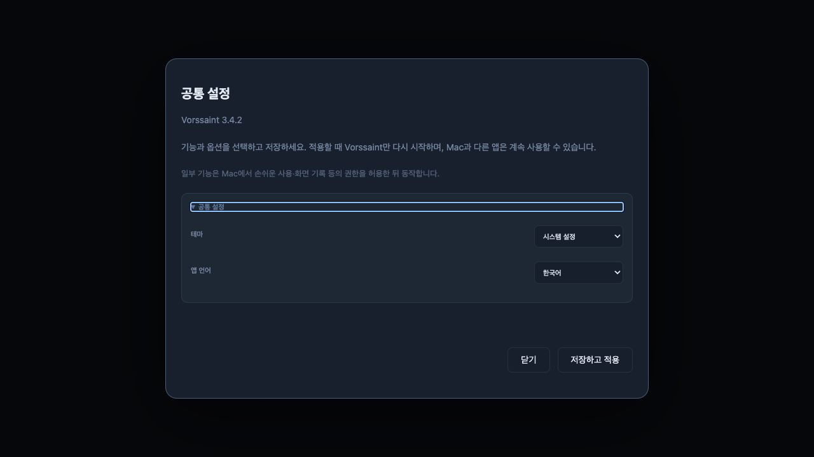

# Open Deck 0.13.0 verification

App source: `4fb746edf8597b91e19605e9e3cf90481e0194ba`, tagged `v0.13.0`, build 24. [Published release and installers](https://github.com/Yaklede/open-deck/releases/tag/v0.13.0).

## Installed behavior

- Installed official signed Vorssaint 3.4.2 on the Mac and verified its signature and Gatekeeper assessment. The integration uses its public preference interface; the app is not bundled into Open Deck.
- Installed the released Open Deck Mac app and signed Android APK over the existing apps. The three existing pages, effective profile configuration, host preferences, four paired devices and their setting values/token hashes were retained. The new page was appended to the default profile.
- Opened all nine utility categories on a physical Samsung Galaxy Tab S7. Native forms read Mac preferences, kept drafts local, saved selected changes and discarded cancelled edits.
- Changed the appearance in the Mac editor form and read it on the tablet; changed it on the tablet and read it back in the Mac editor form. The editor form was exercised through its actual UI module using an isolated loopback fixture in a background browser. No production administrator key was sent to that browser.
- Started a 30-minute keep-awake session from the tablet and observed a real Vorssaint-owned Mac sleep assertion. The stop button released it. All 151 allowlisted preference values were restored after these checks.
- Opened the native settings form in the installed production tablet app over its existing pinned HTTPS Wi-Fi connection. USB remained attached for ADB control; this was not a physical cable-disconnection test.
- Restarted both installed Open Deck apps. The Mac tools page and its connected state returned over Wi-Fi without re-pairing. The Mac operating system was not rebooted. No unrelated macro launchers were invoked.

[Production installation](production-install-result.json), [native form save/cancel](tablet-settings-result.json), [nine categories and real sleep assertion](tablet-utilities-result.json), [cross-device readback](cross-device-settings.json).

## Checks and release

The complete host suite passed 272 tests, including 11 utility integration tests. Coverage includes typed/range validation, preserved unrelated settings, no-op saves, stale revisions, concurrent/failed writes, scoped paired-device access, trusted HTTPS, blocked LAN administrator/browser access, pairing revocation during a streamed POST and editor locking during a streamed POST. Android release lint finished with zero errors and 22 existing warnings. The native helper and release apps compiled successfully.

The tag, embedded Mac source/version/build, Android package/version/build and existing APK signer were checked. All three public release assets were downloaded without authentication and matched the locally built files and GitHub SHA-256 digests. Old releases were retained. Temporary fixture services, their USB forwarding entry and the separate verification APK were removed.

[Check summary](checks.json), [published file hashes and metadata](release-verification.json).

## Scope

The tablet offers 77 feature availability entries and 151 typed fields across nine categories, plus timed keep-awake controls. Advanced app/device lists, per-app volume and complex runtime windows remain in the official Mac app. Saves gracefully restart Vorssaint. This does not claim every Vorssaint runtime action is remotely implemented. New utility metadata is Korean/English with English fallback in other UI locales. See [supported controls and setup](../../vorssaint.md).

Credentials, pairing secrets, private preference snapshots and raw device logs are excluded from these published records.
