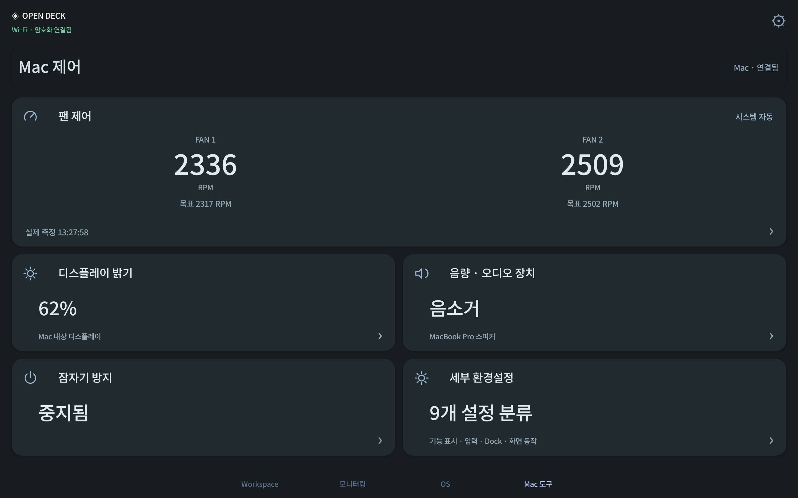

# 0.14.0 direct Mac control evidence

The Mac tools page now controls actual Mac hardware from the native Android app. Verification used a physical Samsung Galaxy Tab S7 (SM-T870), the production Open Deck app, its existing pairing and encrypted Wi-Fi connection. USB was used only for ADB observation and input.

## Hardware results

| Action | Observed result | Evidence |
| --- | --- | --- |
| Tablet maximum cooling button | Both targets changed to 7,826 RPM; measured speeds reached approximately 7,700–7,800 RPM; system automatic mode restored | [readback](fan-manual-result.json), [native tablet](fan-manual-speed-physical.png) |
| Tablet manual-speed slider | 95% applied; both targets read 7,551 RPM | [readback](fan-slider-result.json), [native tablet](fan-slider-physical.png) |
| Tablet temperature curve editor | Selected chip sensor and edited points reached the daemon; both physical fan targets read 7,826 RPM; system mode restored | [readback](fan-curve-result.json), [native tablet](fan-curve-physical.png) |
| Brightness slider | Actual Mac brightness changed 62% → 64%, then restored | [readback](brightness-result.json), [native tablet](tablet-brightness-applied.png) |
| Speaker-volume slider | Actual volume changed 0% → 2% with mute preserved, then restored | [readback](audio-result.json), [native tablet](tablet-audio-applied.png) |
| Keep awake | Real 30-minute IOPM assertion started and was released; official Vorssaint was not restarted | [readback](awake-result.json), [native tablet](tablet-awake-running.png) |
| Mac editor control | Actual shared editor module changed Mac brightness 62% → 63% → 62% in a background loopback browser fixture | [readback](mac-editor-control-result.json), [editor](mac-brightness-applied.png) |
| Advanced preferences | Native nine-category chooser and energy/display settings opened | [native tablet](advanced-category-energy.png) |

The curve used for the hardware check held 100% cooling at both 20°C and 110°C, so the check did not reduce cooling under load. Test values were subsequently returned to the original preset defaults; the fans are in system automatic mode. Brightness, audio device/volume/mute and sleep assertions were restored or preserved. [Restoration record](hardware-restoration-result.json).

## Failure and restart behavior

Only the owned unprivileged MacControlClient process was killed while the tablet's maximum-cooling mode was active. The host immediately retained both fan readings with `available: false` and `stale: true`. After 2.755 seconds, a new client delivered fresh measurements. Both fans were back in system automatic mode. Presets remained saved without replaying manual mode. [Timed observations](fan-disconnect-result.json).

This fault check exposed a read-endpoint gap: opening details during the reconnect delay returned an error instead of the retained sample. The endpoint now returns the last sample with stale/disconnected flags, while mutations still fail explicitly. The same failure scenario was repeated against the installed fix.

Both Mac and Android apps were restarted during verification. Existing core pages, profiles, pairings, host/device settings, fan authorization and presets survived. The tablet reconnected through Wi-Fi and received fresh measurements. The Mac itself was not rebooted. [Preservation record](restart-and-preservation-result.json).

## Automated and package checks

The complete host suite passed 284 tests. Android release compilation and lint passed with zero errors and 22 existing warnings. Both independent native executables compiled and passed their policy checks. Tests cover typed/scoped operations, curve bounds, paired/profile access, trusted HTTPS, blocked browser/LAN administrator access, revocation during POST streaming, preset persistence, disk-save errors, read coalescing, mutation single-flight, deadlines and retained stale samples during native reconnection.

The administrator-approved helper is root-owned and limited to the bounded fan protocol. It authenticates the exact signed client and active console user. The official Vorssaint app/helper is unchanged. No password or administrator credential is included in these records.

[Check summary](checks.json), [control scope and setup](../../vorssaint.md), [release and installers](https://github.com/Yaklede/open-deck/releases/tag/v0.14.0).

