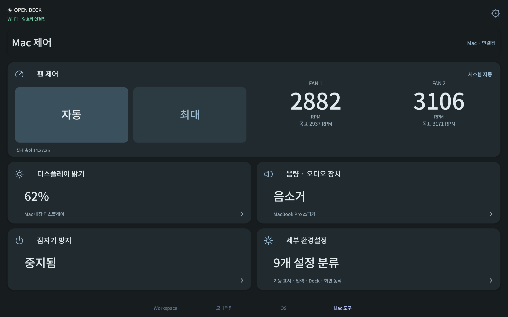

# Open Deck 0.14.1 verification

Physical device: Samsung Galaxy Tab S7 (SM-T870), using the production signed Android app and existing encrypted Wi-Fi pairing. USB was used for ADB observation and touch input. The Mac was not rebooted, and no workspace launcher routine was used.

## Reported failure and fix

Rapid fan-detail taps reproduced a fatal `RejectedExecutionException` in the old MacControlsPanel: multiple pending panels exhausted the four-worker macro executor. The panel previously waited for its network response before creating a window, allowing additional taps to create independent pending requests.

A utility-panel session is now claimed before a request begins. The first window is shown immediately, including a closable loading view; later callbacks cannot reopen a closed session. Subsequent openings reuse the current runtime sample and cached form metadata. Control requests have a separate bounded executor, and rejected work is handled. Advanced category/group navigation replaces its previous window rather than leaving a hidden stack.

## Physical checks

- Twelve rapid taps on the fan-readings region produced **one dialog plus the main activity**. One Back action returned to the deck. After waiting for delayed responses, only the activity remained. Immediate open/cancel also stayed closed. [Window counts and first-frame timings](modal-results.json).
- The first two panel frames were observed after **38 ms and 47 ms**. These measure the first Android draw from the open call, including the immediate loading frame; they are not a guarantee that network data arrives within that time.
- The large main-page **Max** button changed both actual fan targets to their hardware maximum, and **Auto** returned both fans to system automatic control. Neither action opened a modal. [Hardware readback](inline-fan-results.json).
- Advanced category → energy/display group navigation kept one dialog; a single Back returned to the deck. [Navigation counts](advanced-navigation-results.json).
- Twenty rapid page switches exercised Workspace, Monitor, OS and Mac tools. Android FrameStats reported 120 valid frames, median **10.47 ms**, 95th percentile **12.13 ms**, 99th percentile **14.59 ms**. This is a measurement of this device/run; no universal frame-rate or before/after percentage is claimed. [Frame statistics summary](rendering-results.json).
- Existing deck, host preferences, pairings and device settings stayed unchanged. Fan authorization survived the update. The final fan mode is system automatic. [Preservation](preservation-results.json).
- The installed Mac version is 0.14.1/build 26. The physical APK bytes match the release APK, the tablet is online, and the current Android process has no crash record. [Installed apps](installed-results.json).

## Rendering and responsiveness changes

Page switches reuse the serialized configuration supplied by the stream instead of serializing it again on the UI thread. Render signatures are computed lazily for visible providers and reused within a state snapshot, avoiding work on hidden Grafana/OS data. Native views remain cached. Tap transitions use 180 ms and navigation accepts a newer tab choice while an earlier transition is settling. Fan timestamps reuse the date-format cache. The host reuses native samples up to 2.5 seconds old without changing their actual collection timestamp or treating disconnected samples as fresh.

The complete host suite passed **285 tests**. The final affected host/i18n subset passed **35 tests**. The panel-session test covers 100 repeated opening attempts, cancelled callbacks and delayed old dismissals; existing swipe/freshness checks passed. Android release compilation and lint completed with zero errors and 28 warnings.

[Release and installers](https://github.com/Yaklede/open-deck/releases/tag/v0.14.1).

The normal latest release is published at v0.14.1, source commit `451ba407fbb09a4962c19b4e53077cf089a7c0e2`. Both installers and SHA256SUMS.txt were downloaded from their public HTTPS links and matched the local hashes and GitHub asset digests. The downloaded Mac bundle signature, embedded source/version and original Android signing certificate were verified. [Published installer validation](release-verification.json).
