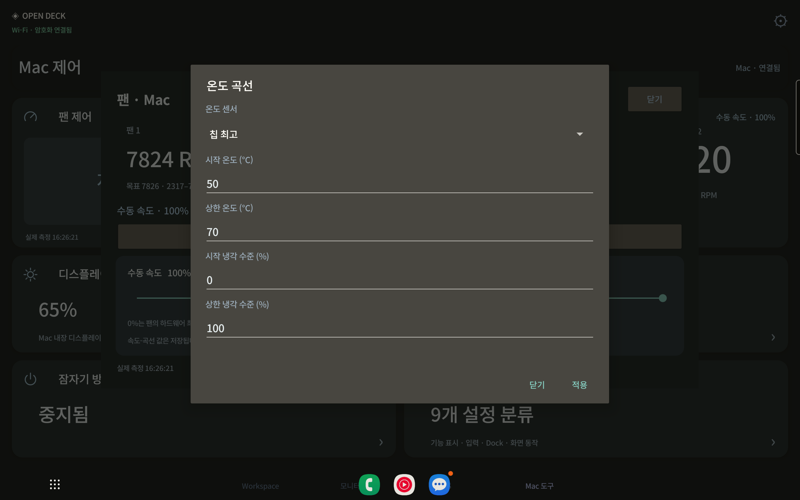
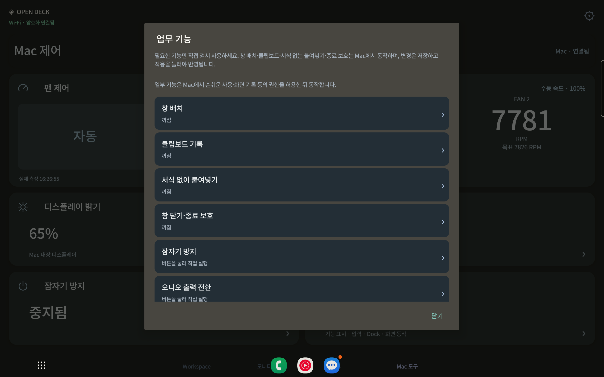

# Open Deck 0.15.0 verification

Physical device: Samsung Galaxy Tab S7 (SM-T870), production signed APK, existing encrypted Wi-Fi pairing; ADB was used for observation and touch input. The Mac itself was not rebooted.

## Bundled typography

The shared AppTypography layer loads NotoSansKR.ttf once at weights 500/700. It handles dialog titles/body, buttons, switches (including switch text), checkboxes, numeric EditText controls, native single-choice/list items, spinner selected rows and lazy dropdown rows. Font padding is disabled to keep native dialogs compact. A form rebuilt after loading gets the same typography again. Choice wrapping preserves the checked selection.

Physical observations covered the fan detail, four curve inputs, the sensor dropdown, audio device picker, awake checkbox, all four work-feature editors, their master switches, the six-feature hub and the generic theme radio picker. There were **35 dialog audits with 510 TextView observations and zero typeface mismatches**, plus 15 lazy dropdown-row observations and two native-list row audits. These are observations across repeated views, not 510 distinct controls. [Font results](font-results.json), [sanitized audit log](font-audit.log), [choice selection](choice-results.json).

[Sensor dropdown](sensor-dropdown-noto.png), [audio chooser](audio-picker-noto.png), [native radio picker](native-radio-choice-noto.png), [compact fan detail](fan-detail-noto-compact.png).

## Six work essentials, opt in

The settings entry now opens a six-item **업무 기능** hub:

| Entry | Current behavior |
| --- | --- |
| Window layout | Draft activation/options for the installed Vorssaint Mac feature |
| Clipboard history | Draft activation/options for Mac-side clipboard history |
| Paste as plain text | Draft activation/options for the Mac behavior |
| Quit/window-close protection | Draft activation/options for the Mac behavior |
| Keep awake | Opens the native tablet direct-control panel |
| Audio output switching | Opens the native tablet direct-control panel |

The first four configure Mac behavior; they do not provide tablet-side clipboard searching or individual window-position buttons. They start from the user's current values, and the four behaviors on this Mac were already off. Opening the hub never changes them. A local master-switch draft updates the relevant behavior keys, and only **저장하고 적용** sends a bounded, category-scoped patch. The two native links do not start a session or switch a device when opened.

On the real tablet, each of the four master switches was changed only in a draft and then cancelled. The Mac values stayed off. Saving the original disabled values completed the progress/reload flow and returned to the hub. Both direct-control links opened the correct native panel. All **151 effective Vorssaint settings remained unchanged** after these production checks. New background collection/automatic behavior was not activated, and clipboard content was never read or transferred by Open Deck. Actual activation/save/disable behavior was additionally covered with an isolated native-adapter fixture. [Work-feature checks](essentials-results.json), [native links](native-links-results.json), [unchanged Mac options](mac-options-preserved.json).

## Validation and installation

The complete host suite passed **286 tests**, including read-only essentials opening, typed allowed keys, explicit enable/disable writes, unrelated-setting preservation and paired/profile restrictions. Android release compilation and lint passed with zero errors and 28 warnings.

The installed Mac app is 0.15.0/build 27; the physical tablet is online with 0.15.0. The installed APK bytes match the release APK, and its font file matches the bundled Noto Sans KR asset. Existing deck, host preferences, pairings and tablet settings were preserved. [Installed-app checks](installed-results.json).

[Release and installers](https://github.com/Yaklede/open-deck/releases/tag/v0.15.0), [integration scope](../../vorssaint.md).

The normal latest GitHub release is v0.15.0, source commit `a515eba32b9e4409904e4a318d93bca6c8994747`. Both installers and SHA256SUMS.txt were downloaded from their public HTTPS URLs and matched local SHA-256 hashes and GitHub asset digests. The downloaded Mac signature and embedded source/version metadata, original Android signer and complete native component source were verified. [Published artifact validation](release-verification.json).
